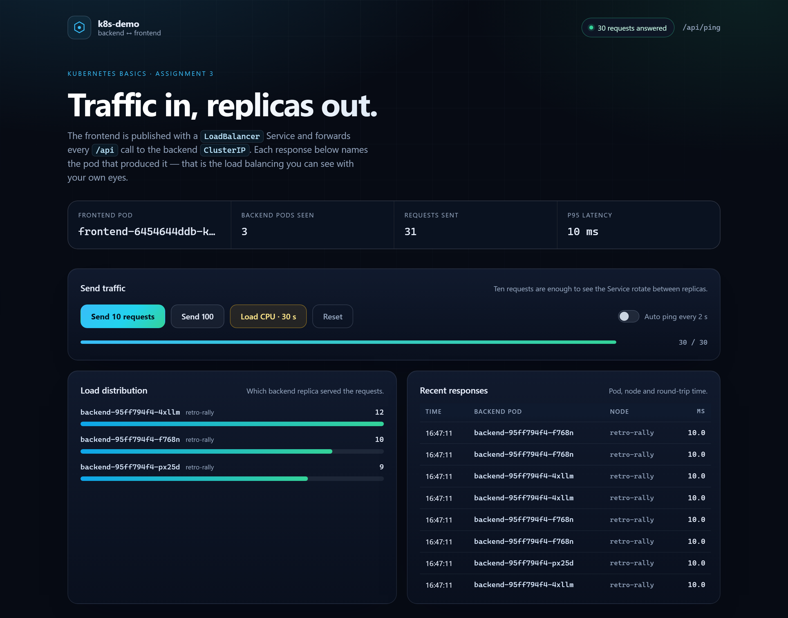
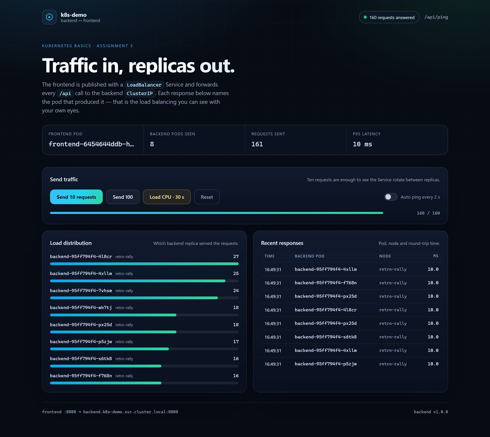

# Kubernetes basics: backend ↔ frontend

A two-tier demo deployed to Kubernetes: a **replicated Node.js backend** behind an internal
`ClusterIP` Service and an **nginx frontend** published with a `LoadBalancer` Service, so it gets an
address usable from outside the cluster. The page shows which backend pod answered each request,
which makes Service load balancing and HPA scaling visible instead of theoretical.

**Live:** <http://176.109.100.164/k8s-demo/> · cluster: k3s v1.36.5, 2 vCPU / 4 GB Ubuntu 22.04 VM

```
Internet ──▶ Service frontend (LoadBalancer :8081) ──▶ 2 × nginx pods
                                                          │  /api/*
                                                          ▼
                                    Service backend (ClusterIP :8080)
                                                          │
                                           3…8 × Node.js backend pods
```

More detail — request flow, object table, design decisions, DoD mapping: [docs/architecture.md](docs/architecture.md).

## Screenshots

| Load balancing across 3 replicas | HPA scaled the backend to 8 replicas under load |
|---|---|
|  |  |

## Repository layout

```
kubernetes-basics/
├── backend/                 Node.js service, no npm dependencies
│   ├── server.js            /api/ping, /api/work, /api/stats, /healthz, /readyz
│   └── Dockerfile           node:22-alpine, non-root
├── frontend/                nginx + static dashboard
│   ├── nginx.conf           listens on 8080, proxies /api to the backend Service
│   ├── public/              index.html, styles.css, app.js
│   └── Dockerfile           nginx-unprivileged:1.27-alpine, non-root
├── k8s/
│   ├── base/                namespace, ConfigMap, 2 Deployments, 2 Services, HPA, PDB
│   └── overlays/
│       ├── local/           kind: Service frontend → NodePort 30080 + kind cluster config
│       └── cloud/           VM: Service frontend → LoadBalancer on port 8081
├── scripts/                 deploy, smoke-test, load-test, build-images, bootstrap-k3s, cleanup
├── docs/architecture.md     diagrams, decisions, DoD checklist
└── Makefile                 shortcuts for the scripts above
```

## Prerequisites

| Where | What |
|---|---|
| VM | Ubuntu/Debian, 2 vCPU, 4 GB RAM, 20 GB disk, a public IPv4 address, SSH access with sudo |
| VM | `docker` (to build images), `curl` |
| Workstation | `kubectl` (the scripts in `scripts/` are bash — run them on the VM or in WSL) |

The manifests are validated against Kubernetes **1.31** schemas (CI) and run on **k3s 1.36.5**.

## Quick start on the VM

```bash
# 1. cluster (single node, Traefik disabled so port 80 stays free)
scp -r kubernetes-basics <user>@<VM_IP>:~/
ssh <user>@<VM_IP>
sudo ./kubernetes-basics/scripts/bootstrap-k3s.sh <VM_IP>

# 2. images (built locally and imported into the k3s containerd — no registry needed)
cd kubernetes-basics
sudo ./scripts/build-images.sh        # sudo: access to the docker socket

# 3. deploy
./scripts/deploy.sh cloud

# 4. verify
./scripts/smoke-test.sh http://<VM_IP>:8081
```

`deploy.sh` prints pods, services, the HPA and the resulting frontend URL.

## Commands

### Deploy and inspect

```bash
kubectl apply -k k8s/overlays/cloud              # create/update every object
kubectl -n k8s-demo get pods -o wide             # 3 backend + 2 frontend replicas
kubectl -n k8s-demo get svc                      # frontend must have an EXTERNAL-IP
kubectl -n k8s-demo get endpoints backend        # the backend Service must have 3+ endpoints
kubectl -n k8s-demo get hpa,pdb
kubectl -n k8s-demo describe deployment backend
```

### Test

```bash
# the page itself
curl -i http://<VM_IP>:8081/

# one request: pod, node, version of the replica that answered
curl -s http://<VM_IP>:8081/api/ping

# five requests: the pod name changes — that is the ClusterIP Service balancing traffic
for i in $(seq 5); do curl -s http://<VM_IP>:8081/api/ping | grep -o '"pod":"[^"]*"'; done

# deterministic CPU work: pi(200000) = 17984
curl -s "http://<VM_IP>:8081/api/work?n=200000"

# everything above, as one script with pass/fail output
./scripts/smoke-test.sh http://<VM_IP>:8081
```

Real output on the VM:

```
$ kubectl -n k8s-demo get svc
NAME       TYPE           CLUSTER-IP     EXTERNAL-IP       PORT(S)          AGE
backend    ClusterIP      10.43.10.141   <none>            8080/TCP         22m
frontend   LoadBalancer   10.43.65.48    176.109.100.164   8081:32751/TCP   22m

$ ./scripts/smoke-test.sh http://127.0.0.1:8081
PASS  frontend / returns 200
PASS  frontend /healthz returns ok
PASS  response carries X-Frontend-Pod header
PASS  GET /api/ping returns a backend pod name
PASS  GET /api/ping returns the node name
PASS  traffic is spread over at least 2 replicas
PASS  GET /api/work returns the expected result
PASS  3+ backend pods are Running
PASS  backend Service has 3+ endpoints
all checks passed
```

### Replication

```bash
kubectl -n k8s-demo scale deployment/backend --replicas=5
kubectl -n k8s-demo get pods -l app=backend

# rolling restart without downtime (maxUnavailable: 0 + preStop hook)
kubectl -n k8s-demo rollout restart deployment/backend
kubectl -n k8s-demo rollout status deployment/backend
```

### Autoscaling

```bash
kubectl -n k8s-demo get hpa backend -w          # TARGETS should stay below 60% when idle
./scripts/load-test.sh 60 4 http://<VM_IP>:8081 # CPU load, 4 workers, HPA watch
```

Measured on the VM: the HPA went from `3/8` to `8/8` replicas while CPU reached 339% of the
requested 60%, then scaled back after the 120 s stabilisation window.

```
16:47:28  hpa=3/8 cpu=1%/60%    running=3
16:48:11  hpa=6/8 cpu=249%/60%  running=6
16:48:21  hpa=6/8 cpu=339%/60%  running=6
$ kubectl -n k8s-demo get hpa
NAME      REFERENCE            TARGETS         MINPODS   MAXPODS   REPLICAS   AGE
backend   Deployment/backend   cpu: 133%/60%   3         8         8          26m
```

### Logs and debugging

```bash
kubectl -n k8s-demo logs -l app=backend --tail=20 --prefix
kubectl -n k8s-demo logs -l app=frontend --tail=20 --prefix
kubectl -n k8s-demo exec deploy/frontend -- wget -qO- http://backend:8080/api/ping
kubectl -n k8s-demo port-forward svc/frontend 8080:8081   # reach it without the external IP
```

### Cleanup

```bash
./scripts/cleanup.sh cloud        # asks for confirmation, deletes the whole namespace
```

## How the live deployment is published

The frontend Service gets a real external address (`EXTERNAL-IP 176.109.100.164`, port 8081).
The cloud provider, however, forwards only port 80 to this VM, so the same nginx that serves the
first assignment proxies a path to the Service:

```nginx
location /k8s-demo/ {
    proxy_pass http://127.0.0.1:8081/;
}
```

Public URL: <http://176.109.100.164/k8s-demo/>. The frontend uses relative URLs, so one image works
both at the Service root and under the path prefix. Details and the provider limitation:
[docs/architecture.md](docs/architecture.md#public-entry-point).

## Local cluster (kind)

The `local` overlay publishes the frontend as a `NodePort` on 30080 and maps it to `localhost:8080`:

```bash
kind create cluster --config k8s/overlays/local/kind-cluster.yaml
kind load docker-image k1io/k8s-demo-backend:1.0.0 k1io/k8s-demo-frontend:1.0.0
kubectl apply -k k8s/overlays/local
curl http://localhost:8080/api/ping
./scripts/smoke-test.sh http://localhost:8080
```

## Configuration

| Variable | Default | Meaning |
|---|---|---|
| `PORT` | `8080` | backend listen port (set in the ConfigMap) |
| `APP_VERSION` | `1.0.0` | shown in the UI and in `/api/ping` |
| `MAX_WORK_LIMIT` | `5000000` | upper bound for `?n=` in `/api/work` |
| `READY_DELAY_MS` | `0` | artificial warm-up; set to `5000` to watch the readiness probe keep a pod out of the Service |

The UI also accepts `?burst=N` (for example `/k8s-demo/?burst=20`) to send N requests on page load —
handy for screenshots and quick checks.

## Security notes

* backend: uid 1000, read-only root filesystem, all capabilities dropped, no privilege escalation;
* frontend: uid 101 (`nginx-unprivileged`), read-only root filesystem, writable `emptyDir` only for
  `/var/cache/nginx` and `/tmp`;
* no Secrets and no credentials are stored in the repository — the demo is stateless;
* only the frontend Service is exposed; the backend has no external address.

## Troubleshooting

| Symptom | Cause / fix |
|---|---|
| `ImagePullBackOff` | the images were not imported into k3s: run `sudo ./scripts/build-images.sh`, check `sudo k3s ctr images list \| grep k8s-demo` |
| `EXTERNAL-IP <pending>` | ServiceLB is disabled or the Service is NodePort: check `kubectl -n kube-system get ds \| grep svclb` and `kubectl -n k8s-demo describe svc frontend` |
| `502 Bad Gateway` from nginx | backend pods are not Ready (`kubectl get pods`), or the Service name in `nginx.conf` does not match |
| HPA shows `<unknown>` for CPU | metrics-server is not ready: `kubectl -n kube-system get pods -l k8s-app=metrics-server`; wait a minute after install |
| port 8081 already in use | another process holds it: `sudo ss -lptn 'sport = :8081'` |
| `smoke-test.sh` sees only one pod | keep-alive connections from a single client can stick to one replica; the script sends 20 separate requests, the UI uses 5 parallel ones |
