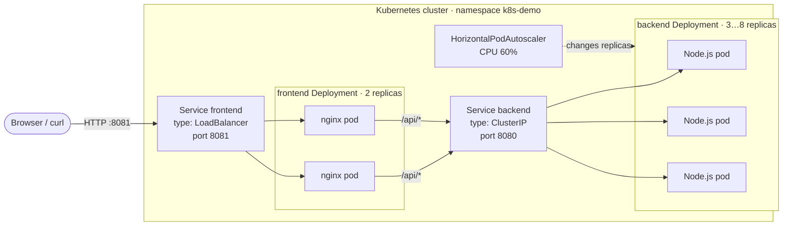

# Architecture

## Request flow



1. A request arrives at the node's external IP on port 8081 — the only port opened by the cluster.
2. `Service frontend` (LoadBalancer) forwards it to one of the two nginx pods.
3. Static files are served by nginx; `/api/*` is proxied to `http://backend:8080`, the cluster DNS name of the `ClusterIP` Service.
4. `Service backend` load-balances the request over the ready backend pods; the response names the pod and the node that handled it.
5. The HPA watches CPU utilisation of the backend pods and adjusts the replica count between 3 and 8.

## Objects

| Object | Kind | Why it exists |
|---|---|---|
| `k8s-demo` | Namespace | Isolates the assignment from everything else on the VM (the first project keeps port 80). |
| `backend-config` | ConfigMap | Port, version and work limits live outside the image. |
| `backend` | Deployment | 3 replicas, rolling update `maxUnavailable: 0`, probes, read-only root filesystem, non-root. |
| `backend` | Service (ClusterIP) | Internal only: reachable from the cluster, never from the internet. |
| `frontend` | Deployment | 2 nginx replicas: the page keeps working while one of them restarts. |
| `frontend` | Service (LoadBalancer) | Provides the address usable outside the cluster. |
| `backend` | HorizontalPodAutoscaler | Keeps 60% average CPU per pod, 3…8 replicas. |
| `backend` | PodDisruptionBudget | A node drain may remove one replica at a time, never more. |

## Design decisions

**Why a LoadBalancer Service and not an Ingress?** The assignment asks for a frontend that "listens on an external port and has an IP usable outside the cluster". A `LoadBalancer` Service delivers exactly that with one object; an Ingress would add an ingress controller (Traefik is disabled on this VM because it binds port 80) and would still need a Service of type LoadBalancer or NodePort underneath.

**Why is the backend ClusterIP?** Only the frontend must be reachable from outside. The backend gets an internal virtual IP and is reachable as `backend.k8s-demo.svc.cluster.local:8080`.

**Why port 8081 in the cloud overlay?** The VM already runs the first assignment behind nginx on port 80. Keeping the demo on 8081 means both projects coexist, and the frontend still gets a real external IP.

**Why nginx and not a Node.js frontend?** The frontend's job here is to publish static files and proxy `/api` — nginx does it with a 25 MB image, no build step and no runtime dependencies. `nginx-unprivileged` also lets the container run as uid 101 with a read-only root filesystem.

## Public entry point

cloud.ru forwards only ports 22 and 80 to this VM; 8081 and 443 are filtered upstream (a TCP
connect is answered by the provider NAT, but nothing reaches the machine). The Kubernetes side is
unaffected: the frontend Service still receives a real external address
(`EXTERNAL-IP 176.109.100.164`, port 8081), which is what the assignment asks for, and it is
reachable from the VM itself and from its private network.

So that the demo is also reachable from the internet, the nginx that already serves the first
assignment proxies a path to the Service:

```nginx
location = /k8s-demo { return 301 /k8s-demo/; }

location /k8s-demo/ {
    proxy_pass http://127.0.0.1:8081/;
    ...
}
```

Public URL: **http://176.109.100.164/k8s-demo/**. The frontend uses relative URLs (`api/ping`,
`styles.css`), so the same image works both at the Service root and under the path prefix. The
nginx config is backed up next to the original (`/etc/nginx/sites-available/retro-rally.bak-*`).

**Why does the response contain the pod name?** `kubectl get pods` shows that replicas exist; only a per-request answer shows that the Service actually spreads traffic. The UI aggregates those answers into a histogram.

**Why `maxUnavailable: 0` and `preStop: sleep 3`?** On a single-node cluster a rollout restarts pods on the same node; without those two settings a short 502 window is possible while endpoints and kube-proxy catch up.

## How the DoD is covered

| Requirement | Where |
|---|---|
| backend Deployment YAML | `k8s/base/backend-deployment.yaml` |
| frontend Deployment YAML | `k8s/base/frontend-deployment.yaml` |
| backend Service YAML | `k8s/base/backend-service.yaml` |
| frontend Service YAML | `k8s/base/frontend-service.yaml` |
| README with run and test commands | `README.md`, `Makefile` |
| Extra files required by the system | Dockerfiles, nginx config, ConfigMap, HPA, PDB, kustomize overlays, scripts, CI |
