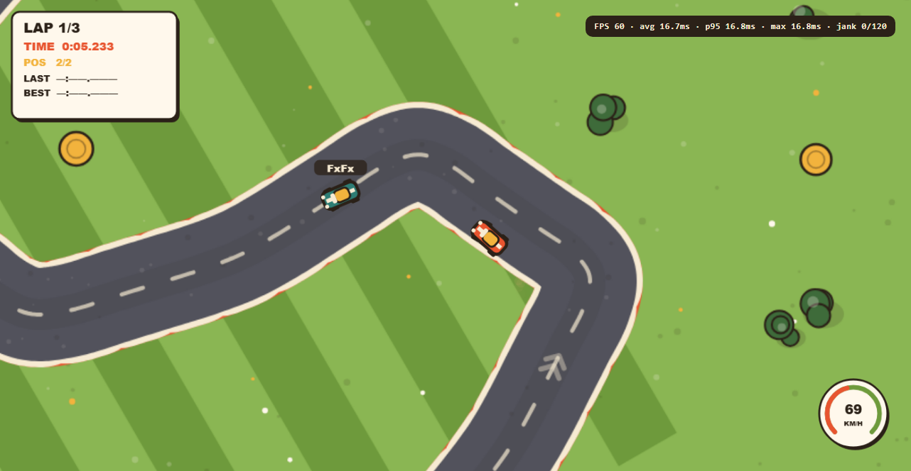
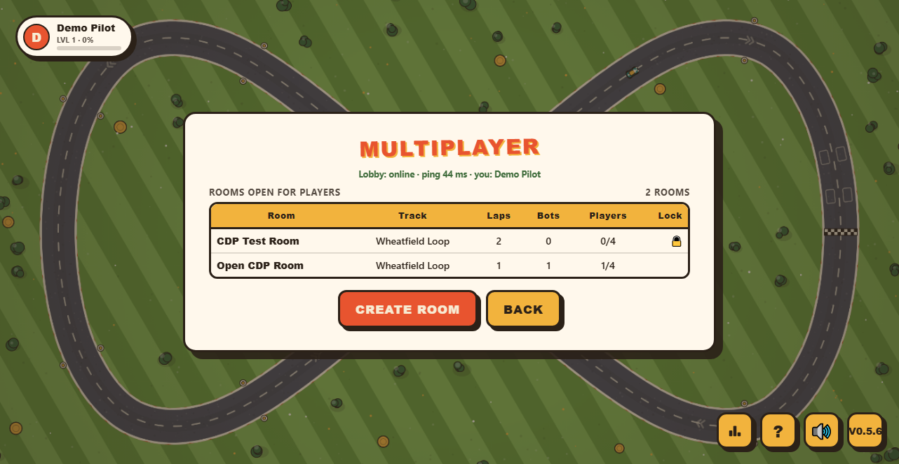
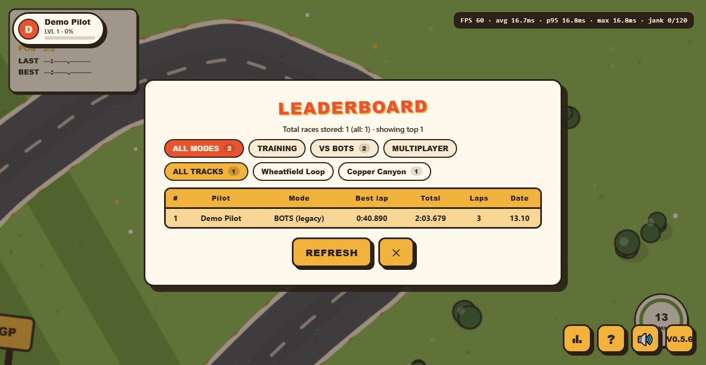

# RETRO RALLY — browser racing game with a cloud-hosted leaderboard

Course assignment: **pick a cloud provider, create a VM and deploy a simple solution**.
The solution itself is a small top-down retro racing game (Reckless Racing style) with an
online leaderboard and a 2–4 player network lobby.

Everything is written from scratch: the game is plain HTML5 Canvas + JavaScript, the server is
Node.js with **zero npm dependencies** (only built-in modules), the UI is drawn procedurally —
no image files, no CDN, works fully offline.



## What is inside

| Part | Description |
|---|---|
| **Game** | Two tracks (Wheatfield Loop with a bridge loop, Copper Canyon), checkpoints that prevent corner cutting, grass slows you down, tyre-post bounces, skid marks and particles |
| **Single player** | Training (solo) and VS BOTS with a selectable number of bots (0–3) |
| **Multiplayer** | Lobby with rooms (up to 4 pilots), password lock, ready check, in-room chat, synchronised 3-2-1 start, live opponents with collisions |
| **Leaderboard** | Best lap, total time, laps, date; track tabs and mode filter (`TRAINING` / `VS BOTS` / `MULTIPLAYER`); JSON storage that survives restarts |
| **Pilot accounts** | Server-side registry: log in from any device with the same name and password; several accounts per device |
| **Admin panel** | `/admin.html`: server state, who is online, rooms, registered pilots, results by mode — protected by an admin key |
| **Sound** | Synthesised engine, countdown beeps and a chiptune music loop with separate music / game volume |
| **Perf meter** | `F3` or `?fps=1` shows FPS, average, p95 and jank counter |

## Tech notes

* Server: `src/server.js` + `src/lib/` — HTTP static hosting, JSON API, Server-Sent Events for the lobby.
* Multiplayer transport: SSE + POST actions (no WebSocket libraries, no packages at all).
* Data lives in plain JSON files next to the server (`src/data/results.json`, `src/data/pilots.json`),
  written atomically (temp file + rename).
* Static assets are served from `src/public/` only, so server code and data are never exposed.

## API

| Method | Path | Purpose |
|---|---|---|
| GET | `/api/health` | server status, uptime, number of stored races |
| GET | `/api/leaderboard` | top-25 with `?track=` and `?mode=` filters |
| POST | `/api/results` | save a race `{playerName, track, mode, laps:[ms]}` |
| GET | `/api/mp/events` | SSE stream of lobby events |
| POST | `/api/mp/action` | lobby actions: `create / join / leave / ready / settings / start / kick / close / chat / state / finish / ping` |
| GET | `/api/mp/rooms` | snapshot of the public room list |
| GET | `/api/mp/stats` | room/connection counters (used by the tests) |
| POST | `/api/pilot/register`, `/api/pilot/login`, `/api/pilot/seen` | pilot registry |
| GET | `/api/admin/summary` | admin summary (requires `x-admin-key`) |

## Run locally

Requirements: Node.js 18+ (tested on 22 and 24). No `npm install` — there are no dependencies.

Double-click **`PLAY.bat`** on Windows: it starts the server and opens the browser.

From a terminal anywhere in the project:

```
npm --prefix src start
```

then open <http://localhost:8080>.

Environment variables: `PORT` (8080), `HOST` (0.0.0.0), `DATA_FILE`, `PILOTS_FILE`,
`ADMIN_KEY` (otherwise the key is generated into `src/data/admin-key.txt`).

## Deployment on a cloud VM

The game is deployed on a **cloud.ru** virtual machine (Ubuntu, nginx in front of Node):
nginx serves the static game from `src/public/` and proxies `/api/` to the Node service on
`127.0.0.1:8080`, so runtime data stays unreachable from outside.

* step-by-step runbook: [deploy/RUNBOOK.md](deploy/RUNBOOK.md) (any Linux VPS — nginx + systemd)
* systemd unit: [deploy/retro-rally.service](deploy/retro-rally.service)
* nginx config: [deploy/nginx-retro-rally.conf](deploy/nginx-retro-rally.conf)
* one-command deploy script: [deploy/deploy.ps1](deploy/deploy.ps1)
* container image: [deploy/Dockerfile](deploy/Dockerfile)

Everything needed on the VM lives in `deploy/`. The container build uses the project root as
context: `docker build -f deploy/Dockerfile -t retro-rally .`



## Checks

```
npm --prefix src run selftest   # tracks, checkpoints and bot laps in Node — no browser needed
npm --prefix src run verify     # API, lobby, registry and admin API on a temporary server
node tools/browser-check.js     # 106 UI checks in headless Chrome (needs a running server)
```

`selftest` and `verify` run offline and use their own data files, so real data is never touched.
`browser-check.js` drives the game through the Chrome DevTools Protocol: registration and login
(including cross-device login and the no-Web-Crypto fallback), lobby and chat, a solo race,
collisions with a live opponent, the FPS meter and the admin panel.

## Project layout

```
retro-rally/
├── PLAY.bat             # Windows launcher: start server + open browser
├── src/                 # the application
│   ├── server.js        # HTTP server: static files + API, no dependencies
│   ├── lib/             # multiplayer lobby, pilot registry, admin API
│   ├── public/          # game client (index.html, css, js modules, admin.html)
│   ├── data/            # runtime data, created on first start (not in git)
│   └── package.json     # npm scripts
├── tools/               # selftest, integration verify, headless browser checks
├── deploy/              # runbook, nginx, systemd, Dockerfile, deploy script — everything for the VM
├── docs/screenshots/    # screenshots used by this README
├── .dockerignore
└── .gitignore
```



## Limitations

* Pilot identity is not cryptographically verified: the client sends a SHA-256 hash of the
  password, the server stores and compares it. Fine for a study project, not for production.
* Lobby rooms live in server memory — restarting the server clears them (accounts and results
  survive).
* Keyboard controls only; not tested on mobile browsers.
